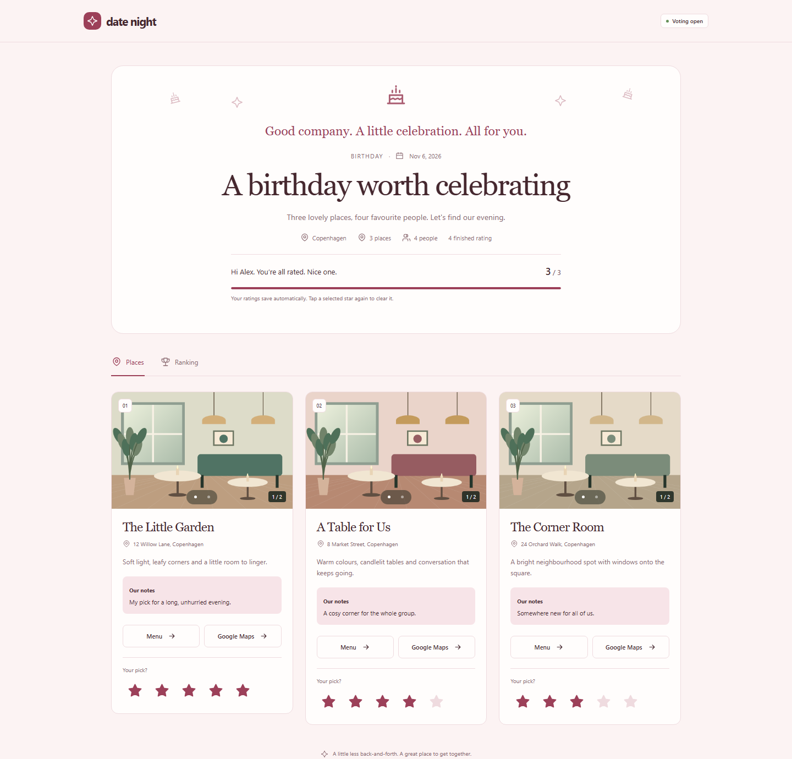
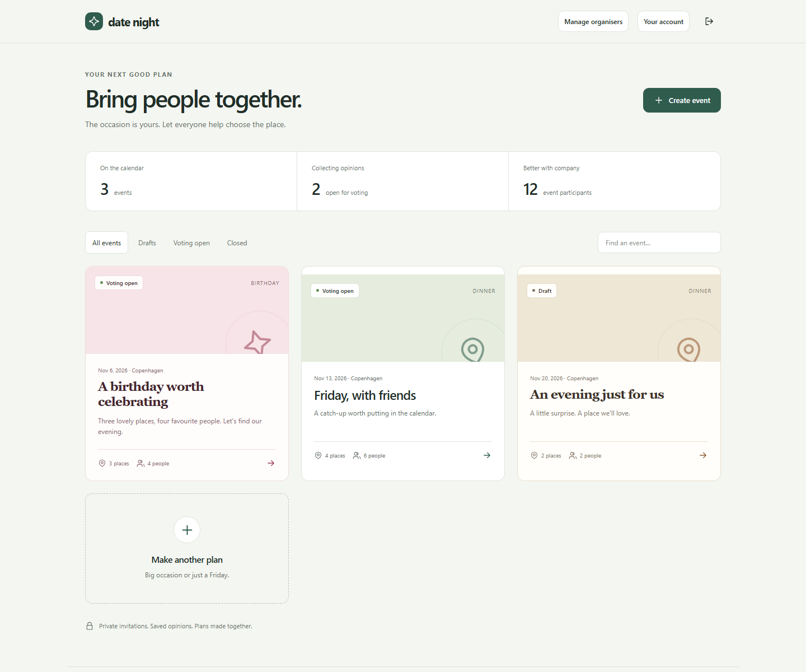
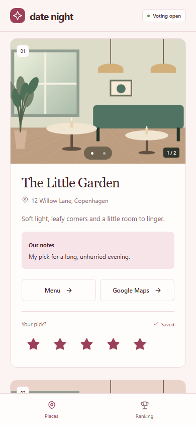
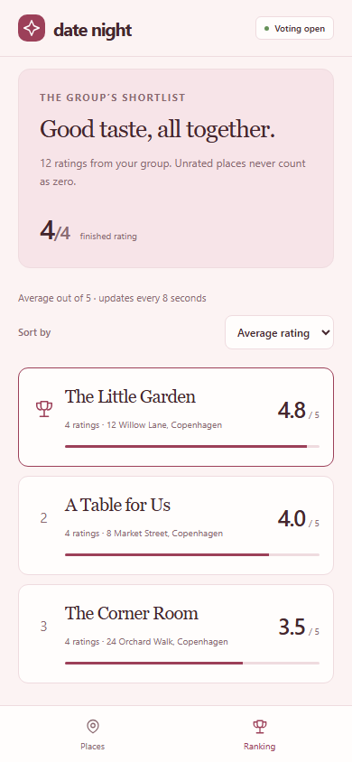
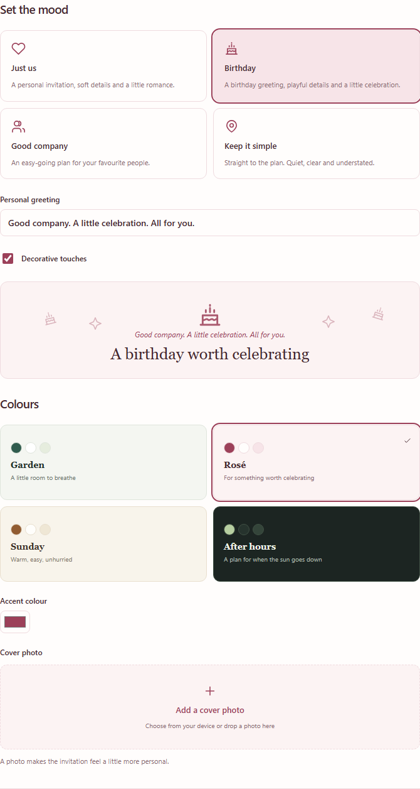

# Date Night

### Less “where shall we go?” More looking forward to it.

A private place to shortlist venues, set the mood, and let everyone have a say.
For birthday dinners, evenings for two, coffee catch-ups, and plans with friends.

**[Open Date Night](https://date-night.onbuyuka.workers.dev/)** ·
**[How it works](#from-maybe-to-made-a-plan)** ·
**[Run your own](docs/development.md)**

*Organiser access is invite-only. Guests join through their personal invitation.*

## Make a plan people want to open

The group chat is great for getting everyone together. Choosing a place?
That usually takes a few more messages.

Date Night gives the plan a home: one shortlist, one invitation, and a clear
picture of what everyone likes. No spreadsheet. No guest signup. No votes
disappearing when someone closes a tab.

| Make it yours | Make it easy |
| --- | --- |
| **A mood, not just a colour.** Romantic, Birthday, Friends and Minimal change the greeting, typography and decoration. Choose the palette separately. | **A link, not another guest account.** Each person gets a private invitation and can start rating straight away. |
| **Your city. Your places.** Start with a Maps link, confirm the branch, and add venues wherever the event is happening. | **Five stars. Saved.** Rate each place from one to five. Change your mind while voting is open. |
| **Show the place.** Add galleries, a menu link, descriptions and personal notes so guests can picture the evening. | **A ranking that updates.** See average scores and rating counts, then close voting when it's time to decide. |

## From “maybe” to “made a plan”

### 1. Give the occasion its own space

Choose a name, date and city. Write a personal greeting and set the mood.
A birthday can be pink and celebratory; a catch-up with friends can feel
entirely different.

### 2. Build the shortlist

Paste a Google Maps link and confirm the right venue and branch. Where the
sources publish usable details, preview website information, menu links and
photo suggestions. **You choose what to keep.** Your own notes and uploads
always remain an option.

### 3. Invite, rate, decide

Send each guest their personal link. They can browse the places, swipe through
photos and rate their favourites on a phone or desktop. Ratings save as they
go; the group ranking refreshes automatically.

<table>
  <tr>
    <th>Give each place a little love</th>
    <th>See where the group lands</th>
  </tr>
  <tr>
    <td></td>
    <td></td>
  </tr>
</table>

Unrated places don't count as zero. Equal scores share a rank. When voting
closes, guests can still see the results without changing their ratings.

## Different plans. Different personalities.

Moods and colours are independent, so you can make a romantic invitation
without making every event look like a date. Add your own accent colour,
cover image and greeting, or keep it simple.

## Private by design

- **Invitation-only organisers.** Only the owner can invite new organisers.
  Account invitations expire and can only be used once.
- **Your events stay yours.** Organisers cannot browse each other's private
  events. The owner doesn't get a special view into them either.
- **Guest access stays with the event.** Voting invitations don't create
  organiser accounts. Replace or revoke a link without deleting saved votes.
- **Access can be paused.** Suspending an organiser pauses their events and
  guest links without deleting their data.

Treat personal invitations like keys: anyone holding a guest link can use
that person's ballot.

## A few honest limits

Date Night helps you **choose a location**. It doesn't reserve tables, verify
availability, import review scores, or guarantee dietary suitability.

Automatic imports are best-effort. Some websites block reading or don't
publish useful metadata; suggested sites and photos need a human check.
Photos are never selected for import automatically and require permission
confirmation. On free hosting, the first website read after inactivity can
take about a minute. Normal browsing and voting don't depend on that reader.

## Get started

**Invited to an event?** Open the personal link your organiser sent you.
You don't need an organiser account.

**Invited to organise?** Use the account invitation to choose your username
and password, then create your first event.

**Want to run your own?** See the [development and deployment guide](docs/development.md)
for local setup, hosting, private credentials, quotas and tests. The current
installation uses free service plans; their limits and terms still apply.

---

*Screenshots show the real application with fictional demo events, people,
venues and votes. Venue illustrations are original demo artwork, not
photographs of real businesses. No private event data is shown.*
